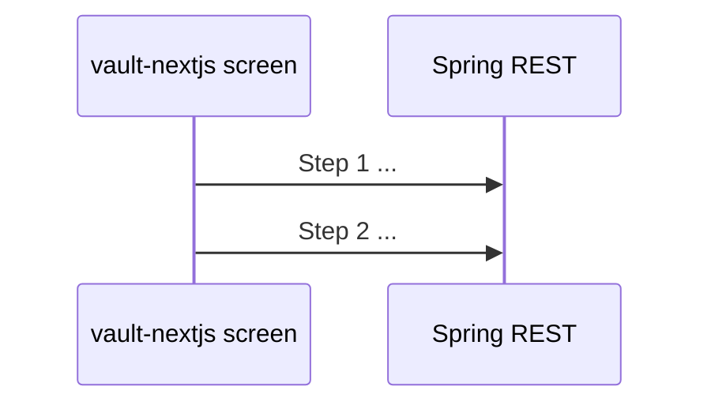

# FE ↔ BE Sequence Wiring Template (Sales Vault)

Persist to: `docs/api/contracts/<artifact_namespace>/<contract_version>/fe-be-sequence-wiring.md`  
Companion notes: `docs/implementation/wiring/<feature-or-slice>-wiring.md` (`traceability_target`)

## Metadata
- `capability_scope` / `feature_or_slice_name`:
- `contract_version`:
- `contract_path`:
- `implementation_frontend_root`: `vault-nextjs/`
- `implementation_module_root`:
- Generated: timestamp · iteration · command `/implement-ui` (wiring gate)

## Sequence source
- [ ] Explicit `api_sequence_specification` supplied
- [ ] Derived from `vault-source-of-truth.md` §7 + `screenRequirements.ts` session deps

## Ordered API sequence

| Step | Depends on | Transport | Operation | Purpose (FR-* / screen) | Request wrapper | Response wrapper |
|---|---|---|---|---|---|---|
| 1 | session context | REST | `GET /warehouses` | Open day / warehouse select | - | `WarehouseListResponse` |
| 2 | 1 | REST | `GET /sales-dates/open` | VAOD / session sales date | - | `OpenDateResponse` |
| 3 | 1, 2 | REST | `GET /pickups` | IND2176 list | query: whse, date, register | `PickupListResponse` |

## Session and routing context

| Context key | Set by step | Consumed by steps | `screenRequirements` note |
|---|---|---|---|
| warehouseId | 1 | 2, 3, … | required on hub screens |
| salesDate | 2 | 3, … | `entry_sales_date` |
| registerNumber | user input | 3+ | `sessionNote: register+pickup` |

## Field binding matrix

| Step | UI control / label | Route | OpenAPI property | DDL column (field-traceability) | `types.ts` interface | `client.ts` adapter |
|---|---|---|---|---|---|---|
| 3 | `label:Register #` | `/vace/pickup` | `registerNumber` | `pickup_entry.register_number` | `PickupApi.list` param | `httpPickupApi.list` |

## Error mapping

| Error code (matrix) | HTTP | User-visible handling | UX source |
|---|---|---|---|
| | | toast / inline field | glossary / screenRequirements |

## Implementation checklist

| Step | Backend controller | FE adapter | Hook / screen | Status |
|---|---|---|---|---|
| 1 | | `warehouseApi` | `useWarehouses` | pending / done |

## Gaps and assumptions

| ID | Type | Description | Owner | Status |
|---|---|---|---|---|
| §12-… | Known gap | | SME | Open |
| ASSUMPTION-001 | Assumption | | | Pending approval |

## Validation evidence
- `rest-api-endpoint-tester` run ID / path:
- `test-case-generator` journey cases:
- Link: `docs/quality/api-validation/<slice>/`

## Conformance
- [ ] Sequence order matches spec; parallelization documented if any
- [ ] All `screenRequirements` required fields bound or gap registered
- [ ] Mock mode (`NEXT_PUBLIC_VAULT_API_MODE=mock`) still works
- [ ] HTTP mode enabled only when full sequence implemented
- [ ] No out-of-scope screens (VACX, VAEX, DDE, STE clerk)
